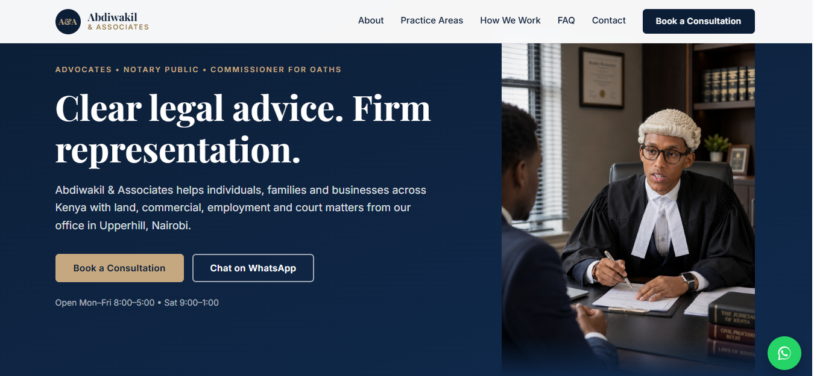

# Abdiwakil & Associates Advocates: Law Firm Website

A responsive, accessible website for a law firm in Upperhill, Nairobi, built with plain HTML, CSS and JavaScript. It helps potential clients understand the firm's services, trust the practice, and get in touch quickly by phone, WhatsApp or an enquiry form.

**Live site:** https://wakiliwebsite.netlify.app/

## Features

- Mobile-first responsive layout with a hamburger menu
- Practice areas, advocate profile, "how we work" steps and an FAQ
- Enquiry form (Formspree) with inline validation, success and error messages, a consent checkbox and a spam honeypot
- Tap-to-call, email and WhatsApp links with a pre-filled message, plus an embedded Google Map
- SEO: meta description, Open Graph tags, `LegalService` structured data, sitemap and robots.txt
- Accessibility: skip link, keyboard-friendly menu, visible focus states, reduced-motion support
- Privacy Policy and Terms & Disclaimer pages, and a custom 404 page
- Security headers and caching rules via `netlify.toml`

## Tech stack

HTML5, CSS3 (custom properties, grid, flexbox), vanilla JavaScript, Formspree, Netlify (continuous deployment from GitHub).

## Project structure

    index.html        Main page
    privacy.html      Privacy policy
    terms.html        Terms and disclaimer
    404.html          Not-found page
    css/style.css     All styles
    js/main.js        Mobile menu and form handling
    images/           Photos
    netlify.toml      Headers and caching

## Run locally

No build step is needed. Open the folder in VS Code and use the Live Server extension on `index.html`, or open `index.html` directly in a browser.

## What I practiced

- Designing a trustworthy, conversion-focused page for a professional services business
- Mobile navigation, form handling with `fetch`, and client-side validation
- Accessibility, SEO and structured data
- Security headers and deployment with Netlify and GitHub

## Planned improvements

- Custom domain and a firm email address
- Online consultation booking
- Legal articles and resources
- Client testimonials, once permitted and compliant with Law Society of Kenya rules

## Developer

**Zak**: finance student with an IT background, interested in web development, data analytics and technology-driven business solutions.